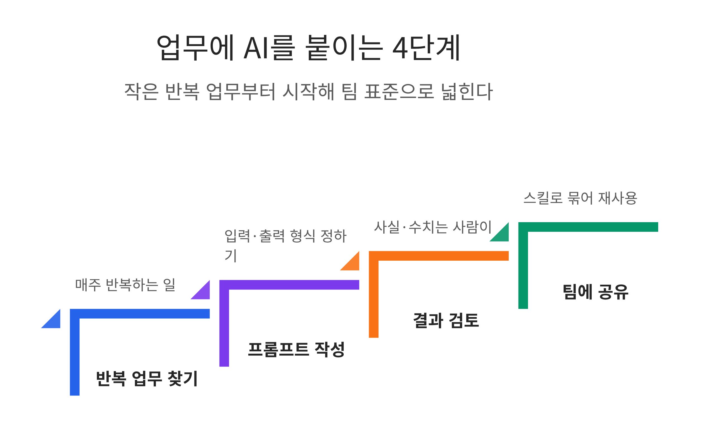
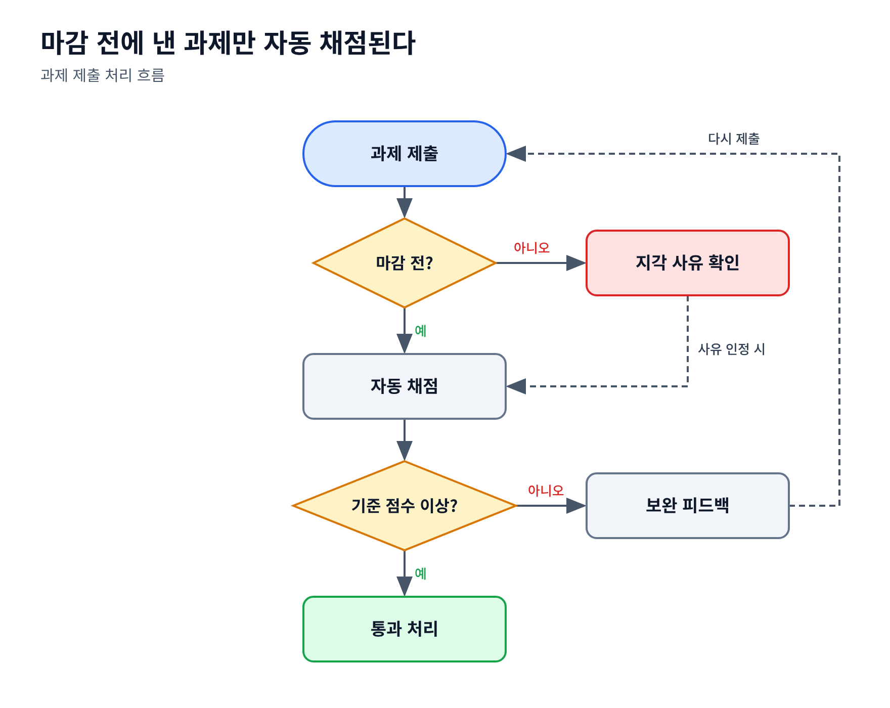
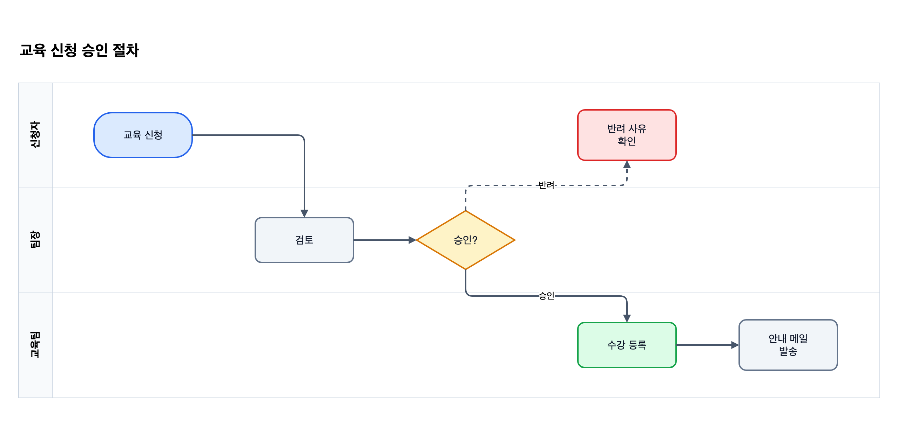
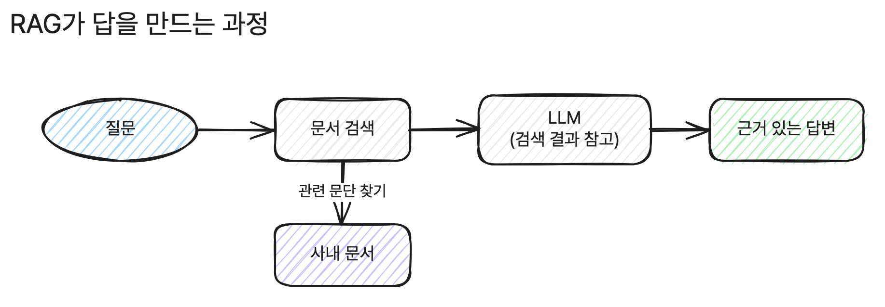
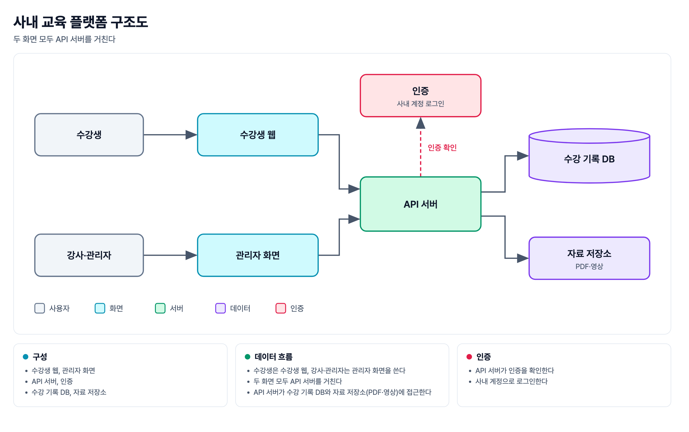

# 예시 프롬프트

설치 후 아래 문장을 그대로 붙여 넣어 보세요. 스킬은 내용의 모양을 보고 방식을 고릅니다. 방식을 정하고 싶으면 문장 끝에 "인포그래픽으로", "draw.io로", "손그림으로"처럼 붙이면 됩니다.

모든 예시는 강의·업무 상황을 가정한 가상 내용입니다.

## 시작 질문

그리기 전에 스킬이 세 가지를 한 번 묻습니다.

| 질문 | 선택지 (맨 앞이 기본값) |
|---|---|
| 어디에 넣나요? | 문서·보고서(세로) / 슬라이드·발표(가로) |
| 어떤 느낌으로 할까요? | 깔끔한 기본 / 손그림 / 어두운 배경 |
| 색은 어떻게 할까요? | 기본 색 / 지정 색(색 이름이나 `#색상값`) |

요청에 미리 적어 두면 그 항목은 묻지 않습니다.

```
과제 제출 처리 흐름을 순서도로 그려줘. 슬라이드에 넣을 가로형, 깔끔한 기본 스타일, 색은 #2E7D8C로. PNG도.
```
```
아래 내용을 인포그래픽으로. 묻지 말고 기본값으로 만들어줘.
```

---

## 1. 인포그래픽 (요점, 단계, 비교, SWOT)



```
아래 내용을 인포그래픽 한 장으로 만들고 PNG도 뽑아줘.
제목: 업무에 AI를 붙이는 4단계
1. 반복 업무 찾기 - 매주 반복하는 일
2. 프롬프트 작성 - 입력·출력 형식 정하기
3. 결과 검토 - 사실·수치는 사람이
4. 팀에 공유 - 스킬로 묶어 재사용
```

```
온라인 강의와 오프라인 강의를 비교하는 인포그래픽 만들어줘.
온라인: 시간 제약이 적다, 질문 응답이 늦다
오프라인: 즉석 피드백, 장소 비용 발생
```

```
사내 AI 교육 과정의 SWOT을 인포그래픽으로 정리해줘.
강점: 실습 위주 / 약점: 강사 수 부족 / 기회: 자동화 수요 증가 / 위협: 무료 외부 강의
```

```
이번 학기 강의 로드맵을 타임라인 인포그래픽으로. 1주 오리엔테이션, 3주 데이터 수집, 6주 모델링, 9주 발표.
```

---

## 2. SVG 순서도 (분기 있는 흐름, 보고서에 바로 붙이기)



```
과제 제출 처리 흐름을 순서도로 그려줘. PNG도.
제출 → 마감 전인지 확인 → 마감 전이면 자동 채점, 아니면 지각 사유 확인(인정되면 자동 채점)
→ 기준 점수 이상이면 통과, 아니면 보완 피드백 후 다시 제출
```

```
로그인 과정을 시퀀스 다이어그램으로 그려줘. 사용자, 웹, 인증 서버 세 참여자.
```

```
수강 신청 상태가 바뀌는 과정을 상태도로: 신청 → 승인 대기 → 승인/반려 → 수강 중 → 수료
```

```
'데이터 분석 입문' 강의 내용을 마인드맵으로 정리해줘. 가지: 데이터 수집, 전처리, 시각화, 모델링
```

---

## 3. draw.io (담당자별 업무 흐름도, 나중에 고칠 그림)



```
교육 신청 승인 절차를 담당자별(신청자, 팀장, 교육팀) 흐름도로 draw.io 파일과 PNG로 만들어줘.
신청자가 신청 → 팀장 검토 → 승인 여부 판단
→ 승인이면 교육팀이 수강 등록 후 안내 메일 발송
→ 반려면 신청자가 반려 사유 확인
```

```
구매 요청부터 지급까지 결재 흐름을 스윔레인으로 그려줘. 요청자, 팀장, 재무팀. 수정할 거라 draw.io로.
```

```
이 회원 테이블 구조를 ER 다이어그램으로 draw.io 링크 만들어줘.
회원(회원ID, 이름, 이메일) 1:N 수강신청(신청ID, 회원ID, 과정ID) N:1 과정(과정ID, 과정명)
```

---

## 4. 엑스칼리드로 (손그림, 화이트보드, 수업 중 함께 고치기)



```
RAG가 답을 만드는 과정을 손그림 느낌으로 그려줘. PNG도.
질문 → 문서 검색 → (사내 문서에서 관련 문단 찾기) → LLM이 검색 결과를 참고 → 근거 있는 답변
```

```
오늘 수업 판서용으로, 지도학습과 비지도학습 차이를 엑스칼리드로 스케치로 그려줘.
```

```
팀 회고 화이트보드 틀을 엑스칼리드로로 만들어줘. 칸: 잘한 점, 아쉬운 점, 다음에 할 일
```

---

## 5. 구조도 (서비스·시스템 구성)



```
사내 교육 플랫폼 구조도를 그려줘. PNG도.
수강생은 수강생 웹, 강사·관리자는 관리자 화면을 쓴다.
두 화면 모두 API 서버를 거치고, API 서버는 인증(사내 계정 로그인)을 확인한다.
API 서버는 수강 기록 DB와 자료 저장소(PDF·영상)에 접근한다.
```

```
이 README를 읽고 프로젝트 구조를 구조도로 그려줘. 모르는 기술 스택은 [확인 필요]로 표시해.
```

---

## 이미지(PNG) 뽑기

| 상황 | 말할 것 |
|---|---|
| 처음부터 PNG까지 | 요청 끝에 "PNG도 뽑아줘" |
| 이미 만든 그림 | "방금 그림 PNG로 뽑아줘" |
| 크게 | "PNG 3배 해상도로" (`--scale 3`) |
| 여러 개 한 번에 | "이 폴더의 .drawio 파일 전부 PNG로" |

Claude Code·Codex에서는 PC에 있는 Chrome이나 Edge로 PNG를 만듭니다(Windows는 Edge가 기본 설치). claude.ai·ChatGPT 웹에서는 결과 HTML을 열어 `PNG로 저장` 버튼을 누르거나, diagrams.net·excalidraw.com에서 내보내기를 쓰면 됩니다.

---

## 고치기

```
2번 단계 설명을 '프롬프트 템플릿 만들기'로 바꿔줘
```
```
색을 파랑 계열 두 가지로만 줄여줘
```
```
어두운 배경으로 다시
```
```
상자 색을 우리 회사 색 #2E7D8C로 바꿔줘. 분기 색은 그대로 둬.
```
```
슬라이드에 넣을 거라 가로형으로 다시 만들어줘
```
```
같은 그림을 영어로도 만들어줘
```
```
가로가 너무 길어. 위에서 아래로 배치해줘
```
```
같은 내용을 draw.io로도 만들어줘
```

## 잘 나오게 쓰는 요령

- 한 장에 메시지 하나. 항목은 9개 이하.
- 단계와 분기를 화살표(→)로 적으면 순서를 정확히 따릅니다.
- 담당자별로 나누고 싶으면 "담당자: A, B, C"를 명시하세요.
- 수치는 직접 주세요. 스킬은 없는 수치를 만들지 않고 `[확인 필요]`로 남깁니다.
- 영어로 요청하면 그림 글자도 영어로 쓰고 영어 글꼴을 씁니다. `plan.md`, `git push` 같은 파일 이름과 명령어는 고정폭 글꼴로 나옵니다.
- 결론 문장을 제목으로 주면 슬라이드에 바로 쓰기 좋습니다. 예: "승인은 팀장 단계에서 가장 오래 걸린다".
