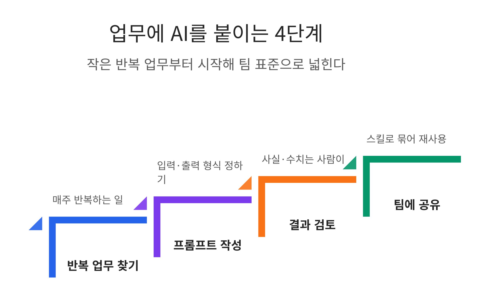
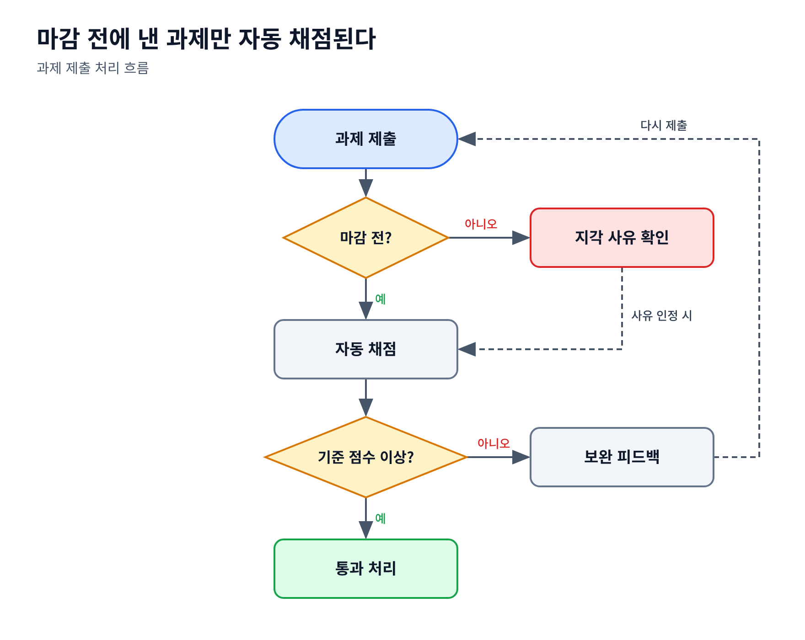
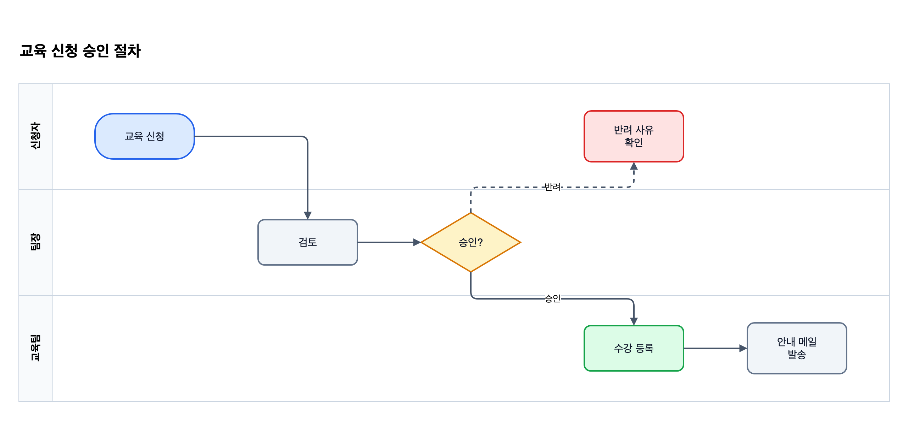
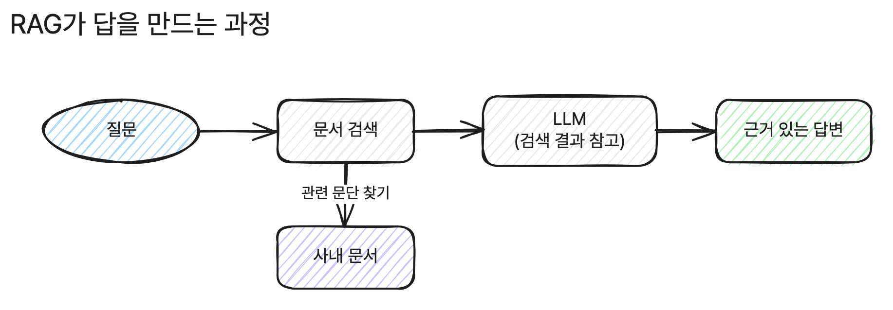
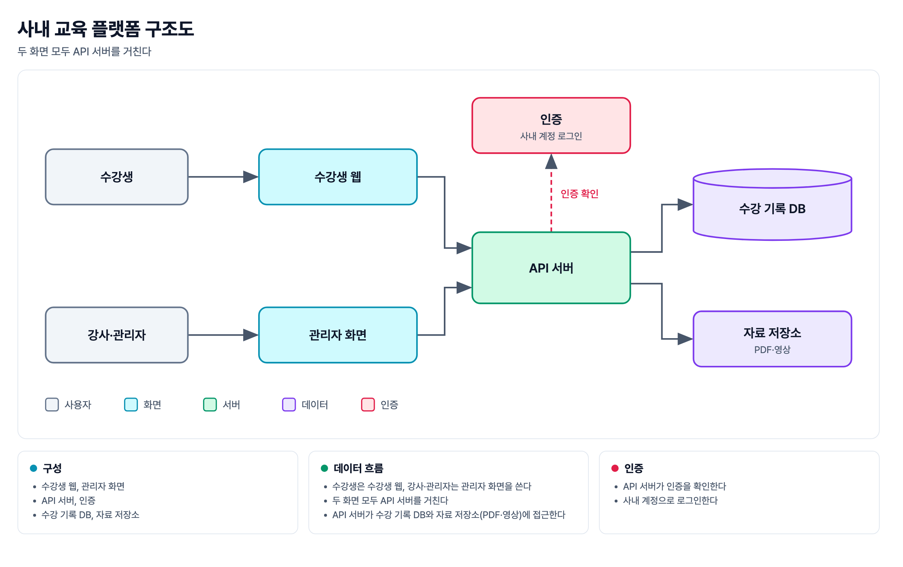

# 한 장 그림 (one-page-diagrams)

글 몇 줄을 보고서·강의자료에 바로 넣을 **그림 한 장**으로 만드는 AI 에이전트 스킬입니다. Claude(Code·웹), Codex, ChatGPT에서 같은 스킬 하나로 씁니다.

- 다섯 가지 그림 방식을 스킬 하나에 묶었습니다. 내용을 보고 알맞은 방식을 스스로 고릅니다.
- 유료 API, 이미지 생성 모델, 로그인, 별도 프로그램 설치가 필요 없습니다.
- 결과는 고칠 수 있는 파일(HTML, SVG, .drawio, .excalidraw)과 **PNG 이미지**입니다.

| 인포그래픽 | 순서도 (SVG) | 업무 흐름도 (draw.io) |
|---|---|---|
|  |  |  |
| **손그림 (엑스칼리드로)** | **구조도** | |
|  |  | |

---

## 1. 설치

쓰는 도구 하나만 골라 설치하면 됩니다.

| 도구 | 가장 쉬운 방법 | 필요한 것 |
|---|---|---|
| Claude Code | 플러그인 명령 2줄 | Claude Code |
| Codex | 플러그인 명령 2줄 또는 폴더 복사 | Codex CLI / 앱 |
| claude.ai (웹·데스크톱) | zip 업로드 | 유료 요금제, 코드 실행 켜기 |
| ChatGPT | zip 업로드 | 스킬 기능이 있는 요금제 |
| Cursor, Gemini CLI 등 | `npx skills add` | Node.js |

### Claude Code

**방법 A. 플러그인 (권장, 업데이트가 쉬움)** — Claude Code 안에서 입력:

```
/plugin marketplace add dschloe/one-page-diagrams
/plugin install one-page-diagrams@one-page-diagrams
```

**방법 B. 스킬 폴더에 복사**

macOS / Linux:
```bash
git clone https://github.com/dschloe/one-page-diagrams.git
mkdir -p ~/.claude/skills
cp -r one-page-diagrams/skills/one-page-diagrams ~/.claude/skills/
```

Windows (PowerShell):
```powershell
git clone https://github.com/dschloe/one-page-diagrams.git
New-Item -ItemType Directory -Force "$HOME\.claude\skills" | Out-Null
Copy-Item -Recurse one-page-diagrams\skills\one-page-diagrams "$HOME\.claude\skills\"
```

특정 프로젝트에서만 쓰려면 `~/.claude/skills/` 대신 프로젝트의 `.claude/skills/`에 복사합니다. 설치 후 Claude Code를 다시 시작하세요.

### Codex

**방법 A. 플러그인**

```bash
codex plugin marketplace add dschloe/one-page-diagrams
codex plugin add one-page-diagrams@one-page-diagrams
```

**방법 B. 스킬 폴더에 복사** — Codex는 사용자 폴더 `~/.agents/skills`, 프로젝트 폴더 `.agents/skills`를 읽습니다.

macOS / Linux:
```bash
git clone https://github.com/dschloe/one-page-diagrams.git
mkdir -p ~/.agents/skills
cp -r one-page-diagrams/skills/one-page-diagrams ~/.agents/skills/
```

Windows (PowerShell):
```powershell
git clone https://github.com/dschloe/one-page-diagrams.git
New-Item -ItemType Directory -Force "$HOME\.agents\skills" | Out-Null
Copy-Item -Recurse one-page-diagrams\skills\one-page-diagrams "$HOME\.agents\skills\"
```

### claude.ai (웹·데스크톱 앱)

1. [`dist/one-page-diagrams.zip`](dist/one-page-diagrams.zip)을 내려받습니다(파일 화면에서 Download).
2. claude.ai → **Customize** → **Skills** → **+** → **Upload a skill** → zip 선택.
3. 설정에서 코드 실행(파일 생성) 기능이 켜져 있어야 파일과 PNG가 만들어집니다.

### ChatGPT

1. [`dist/one-page-diagrams.zip`](dist/one-page-diagrams.zip)을 내려받습니다.
2. ChatGPT → **Skills** → **Create** → **Upload from your computer** → zip 선택.
3. 업로드 직후 바로 안 잡히면 몇 분 뒤 새 대화에서 다시 시도하세요.

### 그 밖의 에이전트 (Cursor, Gemini CLI, GitHub Copilot, OpenCode 등)

```bash
npx skills add dschloe/one-page-diagrams
```

설치할 에이전트를 묻는 화면이 나오면 고릅니다. Node.js가 필요합니다.

---

## 2. 사용법

설치 후 평소처럼 부탁하면 됩니다.

```
교육 신청 승인 절차를 담당자별(신청자, 팀장, 교육팀) 흐름도로 그려줘. PNG도.
신청 → 팀장 검토 → 승인이면 교육팀이 수강 등록, 반려면 신청자가 사유 확인
```

그리기 전에 스킬이 세 가지를 한 번 묻습니다. 요청에 미리 적어 두면 묻지 않습니다.

| 질문 | 선택지 (맨 앞이 기본값) |
|---|---|
| 어디에 넣나요? | 문서·보고서(세로) / 슬라이드·발표(가로) |
| 어떤 느낌으로 할까요? | 깔끔한 기본 / 손그림 / 어두운 배경 |
| 색은 어떻게 할까요? | 기본 색 / 지정 색(색 이름이나 `#색상값`) |

"알아서 해줘"라고 하면 묻지 않고 기본값으로 만듭니다. 만든 뒤에도 "가로형으로", "어두운 배경으로", "색을 #2E7D8C로"처럼 말하면 바꿉니다.

방식별 예시 프롬프트 20여 개는 **[PROMPTS.md](PROMPTS.md)** 에 있습니다.

### 다섯 가지 방식

| 내용의 모양 | 방식 | 결과 | 여는 곳 (모두 무료·설치 없음) |
|---|---|---|---|
| 요점, 단계, 비교, SWOT, 간단한 수치 | 인포그래픽 ([AntV](https://github.com/antvis/infographic)) | `.html` + PNG | 웹 브라우저 |
| 분기 있는 순서도, 시퀀스, 상태도, 마인드맵 | SVG 다이어그램 | `.svg` + PNG | 브라우저, PowerPoint·Word에 바로 삽입 |
| 담당자별 업무 흐름도, 나중에 고칠 그림 | [draw.io](https://www.drawio.com) | `.drawio` + 편집 링크 + PNG | https://app.diagrams.net |
| 손그림, 화이트보드, 수업 중 함께 고치기 | [Excalidraw](https://excalidraw.com) | `.excalidraw` + PNG | https://excalidraw.com |
| 서비스·시스템 구성 | 구조도 | `.html` + PNG | 웹 브라우저 |

---

## 3. 이미지(PNG) 뽑기

요청할 때 "PNG도 뽑아줘"라고 붙이면 됩니다. 이미 만든 그림은 "방금 그림 PNG로"라고 하면 됩니다.

- **Claude Code·Codex**: PC에 설치된 Chrome 또는 Edge를 화면 없이 실행해 2배 해상도 PNG를 저장합니다. Windows에는 Edge가 기본으로 있어 따로 설치할 것이 없습니다. 인포그래픽·draw.io·엑스칼리드로는 그릴 때 인터넷 연결이 필요합니다.
- **claude.ai·ChatGPT 웹**: 실행 환경에 따라 PNG 자동 생성이 안 될 수 있습니다. 그때는
  - HTML(인포그래픽·구조도): 브라우저로 열고 오른쪽 위 **PNG로 저장** 버튼
  - .drawio: app.diagrams.net → 파일 → 내보내기 → PNG
  - .excalidraw: excalidraw.com → 메뉴 → 이미지 내보내기

직접 실행할 수도 있습니다(Python 3, 표준 라이브러리만 사용):

```bash
python3 scripts/to_png.py 그림.drawio            # 그림.png
python3 scripts/to_png.py 그림.svg --scale 3     # 3배 해상도
```

Windows에서는 `python3` 대신 `python` 또는 `py`를 씁니다.

---

## 4. 업데이트와 삭제

| 설치 방법 | 업데이트 | 삭제 |
|---|---|---|
| Claude Code 플러그인 | `/plugin marketplace update one-page-diagrams` | `/plugin uninstall one-page-diagrams@one-page-diagrams` |
| 폴더 복사 | 저장소를 `git pull` 후 다시 복사 | 복사한 `one-page-diagrams` 폴더 삭제 |
| claude.ai·ChatGPT | 새 zip을 다시 업로드 | Skills 화면에서 삭제 |

---

## 5. 자주 묻는 질문

**정말 무료인가요?**
스킬 자체와 그림을 여는 도구(브라우저, diagrams.net, excalidraw.com)는 무료입니다. 스킬을 실행하는 AI 도구(Claude, ChatGPT, Codex)의 요금제는 각자 따릅니다.

**사내 정보가 밖으로 나가나요?**
스킬은 외부 서버에 그림 내용을 보내지 않습니다. 다만 draw.io **편집 링크**는 그림 내용이 링크 주소 안에 들어 있으니, 사내 정보가 담긴 링크는 공유하지 마세요. PNG 변환 시 브라우저는 그리기 라이브러리(AntV, draw.io 뷰어, Excalidraw)만 인터넷에서 내려받습니다.

**한글이 깨지나요?**
SVG·구조도는 PC의 한글 글꼴(맑은 고딕, Apple SD 산돌고딕 Neo, Noto Sans KR 등)을 씁니다. 엑스칼리드로 손글씨 글꼴에는 한글이 없어 한글은 시스템 글꼴로 보입니다.

**스킬이 호출되지 않아요.**
"one-page-diagrams 스킬로" 또는 "한 장 그림 스킬로"라고 앞에 붙여 보세요. 설치 후에는 앱을 다시 시작하거나 새 대화를 여세요.

---

## 6. 폴더 구조

```
one-page-diagrams/
├── skills/one-page-diagrams/     # 스킬 본체 (이 폴더만 복사하면 됨)
│   ├── SKILL.md                  # 방식 고르기 + 공통 규칙
│   ├── references/               # 방식별 상세 규칙 5개
│   ├── assets/                   # HTML 틀 (인포그래픽, 구조도)
│   └── scripts/                  # build.py, to_png.py, check.py, drawio_link.py
├── examples/                     # 예시 원본과 PNG
├── dist/one-page-diagrams.zip    # claude.ai·ChatGPT 업로드용
├── PROMPTS.md                    # 예시 프롬프트
├── .claude-plugin/               # Claude Code 플러그인
├── .codex-plugin/, .agents/      # Codex 플러그인
└── NOTICE.md                     # 참고한 공개 프로젝트와 라이선스
```

## 7. 라이선스와 출처

MIT License. 아래 공개 프로젝트의 규칙과 형식을 참고해 한국어로 다시 썼습니다. 자세한 내용은 [NOTICE.md](NOTICE.md).

- [antvis/infographic](https://github.com/antvis/infographic) (MIT)
- [JimLiu/baoyu-skills](https://github.com/JimLiu/baoyu-skills) (MIT)
- [jgraph/drawio-mcp](https://github.com/jgraph/drawio-mcp) (Apache-2.0)
- [excalidraw/excalidraw-mcp](https://github.com/excalidraw/excalidraw-mcp) (MIT)
- [Cocoon-AI/architecture-diagram-generator](https://github.com/Cocoon-AI/architecture-diagram-generator) (MIT)

---

# one-page-diagrams (English)

An agent skill that turns a few lines of text into **one diagram** for slides and reports. One skill for Claude (Code and web), Codex and ChatGPT. It picks one of five methods (AntV infographic, SVG flowchart, draw.io workflow, Excalidraw sketch, architecture diagram) and outputs an editable file plus a PNG. No paid API, no image model, no sign-in.

**Install**

- Claude Code: `/plugin marketplace add dschloe/one-page-diagrams` then `/plugin install one-page-diagrams@one-page-diagrams`
- Codex: `codex plugin marketplace add dschloe/one-page-diagrams` then `codex plugin add one-page-diagrams@one-page-diagrams`, or copy `skills/one-page-diagrams` into `~/.agents/skills/`
- claude.ai / ChatGPT: upload `dist/one-page-diagrams.zip` in the Skills settings
- Others: `npx skills add dschloe/one-page-diagrams`

**PNG export**: ask "also export PNG". Locally it uses your installed Chrome or Edge in headless mode (`scripts/to_png.py`).

MIT License. See [NOTICE.md](NOTICE.md) for the projects this skill adapts.
